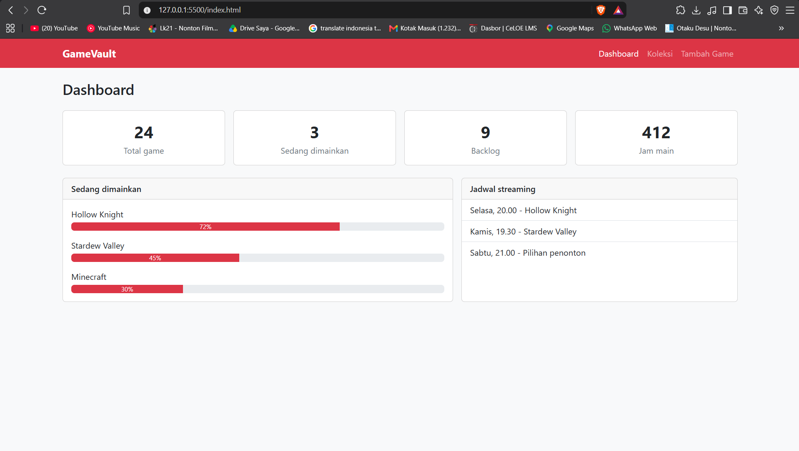
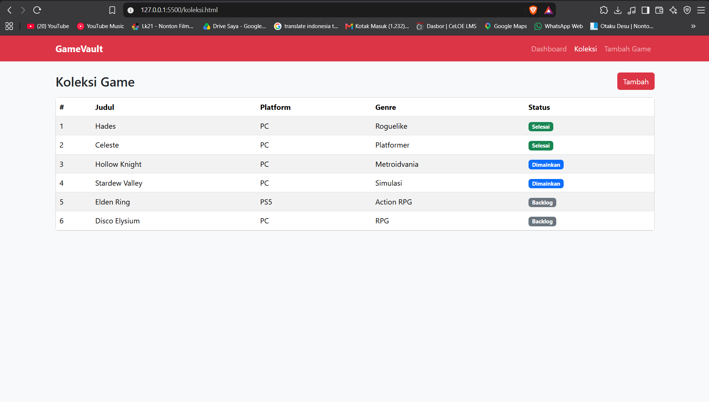
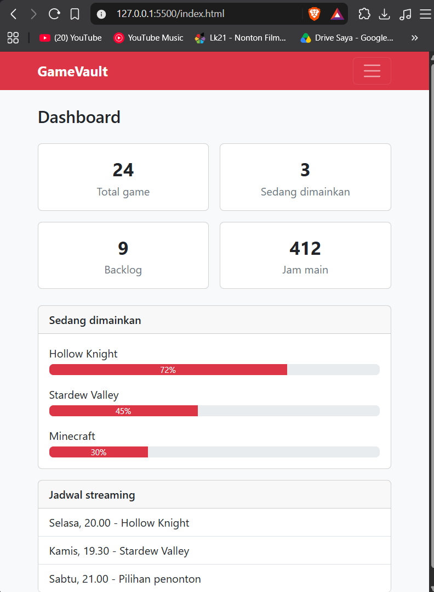
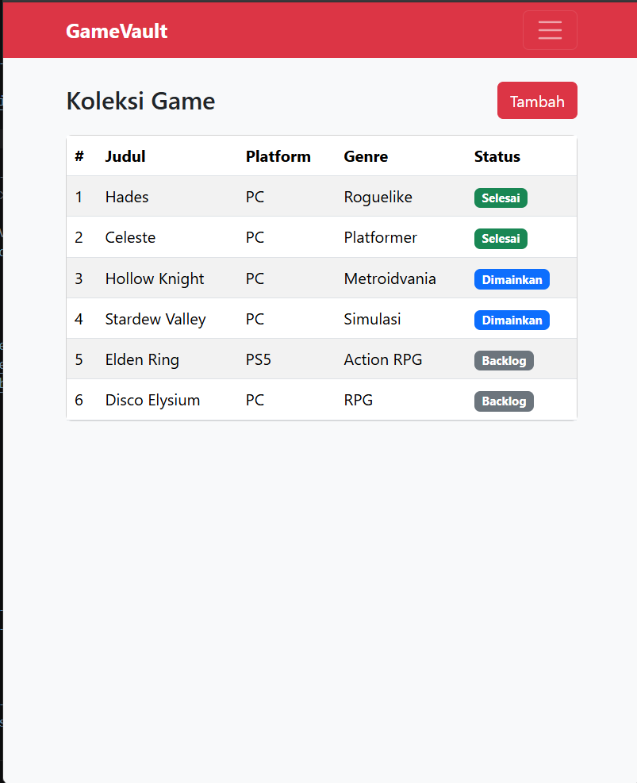
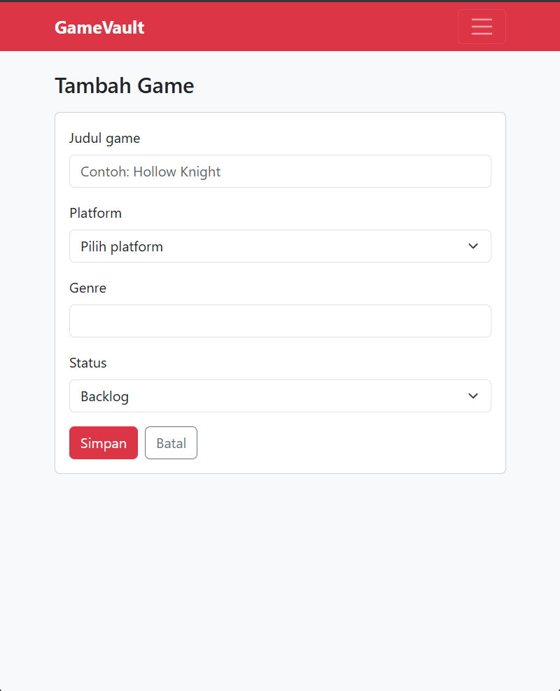

# GameVault

Aplikasi web untuk mencatat koleksi game pribadi (status, platform, genre) dan jadwal streaming. Repositori ini berisi kerangka frontend menggunakan Bootstrap 5; belum terhubung ke backend atau database.

## Halaman
- `index.html` - Dashboard (grid kartu statistik)
- `koleksi.html` - Tabel daftar game
- `tambah-game.html` - Form tambah game

Navbar bersifat responsif: berubah menjadi menu hamburger di layar kecil.

## Cara menjalankan
Buka `index.html` di browser (perlu internet untuk memuat Bootstrap dari CDN).

## Alasan memilih Bootstrap
GameVault berisi dashboard, tabel, dan form, yaitu komponen yang sudah tersedia di Bootstrap (card, table, form, navbar). Sistem grid-nya membuat tampilan otomatis menyesuaikan layar HP dan desktop tanpa banyak CSS, sehingga cocok untuk membangun kerangka aplikasi dengan cepat.

## Screenshot

### Desktop

### Mobile

## Pembuat
Raditya Prasna Putra Dharmawan
